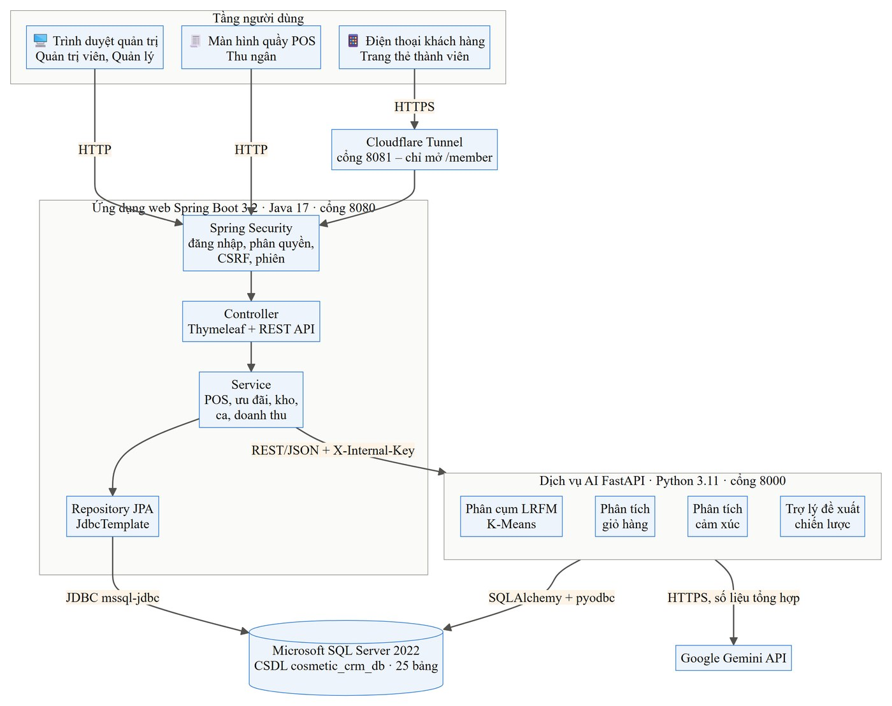

# Hệ thống phân tích và phân cụm khách hàng ứng dụng AI hỗ trợ đề xuất chiến lược kinh doanh

**Đồ án chuyên ngành** – Khoa Công nghệ Thông tin, Trường Đại học Tài nguyên và Môi trường TP.HCM
**Sinh viên thực hiện:** Nguyễn Thị Hà – MSSV 1250080047 – Lớp 12_ĐH_THMT
**Giảng viên hướng dẫn:** ThS. Lê Tuấn Thu

Hệ thống bán hàng tại quầy (POS) cho một cửa hàng mỹ phẩm, tích hợp trí tuệ nhân tạo để **phân cụm khách hàng theo hành vi mua sắm (LRFM + K-Means)**, đề xuất và áp dụng **chiến lược ưu đãi riêng cho từng nhóm khách**, đồng thời **đo hiệu quả ưu đãi** bằng nhóm đối chứng. Dữ liệu được thiết kế và lưu trữ trên **Microsoft SQL Server**.

📘 **Tài liệu:** [Hướng dẫn cài đặt](docs/HUONG_DAN_CAI_DAT.md) · [Hướng dẫn sử dụng](docs/HUONG_DAN_SU_DUNG.md) · [Hướng dẫn quản trị và đọc báo cáo](ADMIN_GUIDE.md)

---

## Chức năng chính

| Nhóm | Chức năng |
|---|---|
| **Phân tích khách hàng & AI** | Tính LRFM cho mọi khách; phân cụm K-Means; chọn số nhóm bằng Elbow, Silhouette, Davies–Bouldin; đặt tên nhóm tự động; mô hình nền có phiên bản; phát hiện lệch dữ liệu và huấn luyện lại có kiểm soát; dashboard trực quan |
| **Chiến lược kinh doanh** | Ưu đãi theo từng nhóm khách (giảm giá, quà tặng, lời tư vấn); trợ lý AI (Google Gemini) đề xuất chiến lược; đo hiệu quả ưu đãi bằng nhóm đối chứng 10%; gợi ý mua kèm bằng luật kết hợp |
| **Bán hàng tại quầy (POS)** | Mở / kết ca, đối soát tiền mặt; tra cứu khách bằng SĐT, mã khách hoặc quét QR; áp dụng ưu đãi đã duyệt tự động; đổi điểm; thanh toán tiền mặt, chuyển khoản, thẻ |
| **Quản lý cửa hàng** | Sản phẩm, danh mục; kho theo lô và hạn dùng (FEFO); khách hàng; hóa đơn; doanh thu, so sánh kỳ, lợi nhuận gộp; xuất CSV |
| **Thẻ thành viên** | Khách đăng ký / kích hoạt thẻ trên điện thoại, mã QR đổi mỗi 60 giây, tích điểm, hạng thẻ, đánh giá sản phẩm (có phân tích cảm xúc) |
| **Hệ thống** | Đăng nhập, phân quyền 3 vai trò (Quản trị viên, Quản lý, Thu ngân), quản lý tài khoản |

---

## Kiến trúc và công nghệ



| Thành phần | Công nghệ | Cổng |
|---|---|---|
| Ứng dụng web (giao diện, nghiệp vụ, phân quyền) | Java 17+, Spring Boot 3.2.5 (Web MVC, Security, Data JPA, Validation), Thymeleaf, HTML/CSS/JavaScript | 8080 |
| Dịch vụ AI | Python 3.11, FastAPI, pandas, NumPy, scikit-learn, SQLAlchemy + pyodbc, google-genai | 8000 |
| Cơ sở dữ liệu `cosmetic_crm_db` (25 bảng) | Microsoft SQL Server 2019/2022, T-SQL | 1433 |

Trình duyệt chỉ làm việc với Spring Boot. Spring Boot kiểm tra quyền rồi gọi dịch vụ AI qua REST/JSON kèm khóa nội bộ `X-Internal-Key`. Hai dịch vụ dùng chung một CSDL SQL Server.

---

## Cấu trúc thư mục

```text
cosmetic-crm-ai/
├── frontend-pos/   Ứng dụng web Spring Boot (POS, trang quản trị, thẻ thành viên)
│   └── src/main/java/com/example/PhanTichAI/
│       ├── controller/   API và trang web
│       ├── service/      Nghiệp vụ: thanh toán, ưu đãi, kho, ca, doanh thu, thành viên…
│       ├── repository/   Truy vấn JPA
│       ├── entity/       25 lớp ánh xạ 25 bảng SQL Server
│       └── security/     Đăng nhập, phân quyền, cổng thẻ thành viên
├── backend-pos/    Dịch vụ AI FastAPI: clustering_service.py (phân cụm LRFM), basket_service.py,
│                   sentiment_service.py, assistant_service.py, main.py, tests/
├── database/       schema.sql, migrations/001…008, build_database.py, migrate.py, seed_store_sales.py
├── data/           raw/OnlineSales.xlsx, prepare_dataset.py, quy tắc nhóm hàng, tên sản phẩm tiếng Việt
├── docs/           Hướng dẫn cài đặt, hướng dẫn sử dụng (kèm ảnh giao diện)
└── scripts/        public-member.cmd: mở trang thẻ thành viên ra Internet (Cloudflare Tunnel)
```

---

## Cài đặt nhanh

Yêu cầu: Windows 10/11, **Java 17+**, **Maven** (hoặc `mvnw.cmd` có sẵn), **Python 3.11**, **SQL Server 2019/2022** đã bật đăng nhập bằng tài khoản SQL và TCP cổng 1433, **ODBC Driver 17 for SQL Server**. Hướng dẫn chi tiết từng bước và xử lý sự cố: [docs/HUONG_DAN_CAI_DAT.md](docs/HUONG_DAN_CAI_DAT.md).

```powershell
cd D:\CODING\cosmetic-crm-ai
Copy-Item backend-pos\.env.example backend-pos\.env    # điền DB_SERVER, DB_USER, DB_PASSWORD
python -m pip install -r backend-pos\requirements.txt
python data\prepare_dataset.py                         # làm sạch OnlineSales.xlsx -> data\processed
python database\build_database.py                      # tạo cosmetic_crm_db và nạp dữ liệu (~4 phút)
```

Chạy hai dịch vụ (hai cửa sổ PowerShell, Spring Boot trước):

```powershell
cd frontend-pos;  mvn spring-boot:run
cd backend-pos;   python -X utf8 -m uvicorn main:app --port 8000
```

Mở <http://localhost:8080/login>. Với CSDL mới: vào **Mô hình phân cụm** → chọn số nhóm → **Xem trước** → **Áp dụng phiên bản này**, rồi vào **Chiến lược ưu đãi** điền và bật ưu đãi cho từng nhóm.

**Tài khoản demo** (mật khẩu `123456`, chỉ dùng để trình bày; tắt bằng `app.demo-accounts.enabled=false` khi dùng thật):

| Tài khoản | Vai trò | Dùng để |
|---|---|---|
| `admin` | Quản trị viên | Toàn quyền, quản lý tài khoản |
| `manager` | Quản lý | Mô hình phân cụm, ưu đãi, báo cáo, ca làm việc |
| `nhanvien1`, `nhanvien2`, `nhanvien3` | Thu ngân | Bán hàng tại quầy POS theo ca |

Cập nhật CSDL đang dùng sau khi lấy mã mới: `python database\migrate.py` (chỉ thêm bảng/cột, chạy lại nhiều lần vẫn an toàn). **Không** dùng `build_database.py --recreate` trên CSDL đang dùng vì sẽ xóa hóa đơn đã bán.

---

## Dữ liệu

**Nguồn:** tệp `data/raw/OnlineSales.xlsx` – bộ dữ liệu thực hành đi kèm sách *Essentials of Marketing Analytics* (Joseph F. Hair Jr., Dana E. Harrison, Haya Ajjan; McGraw Hill, 2021, ISBN 9781260597745). Gồm 250.000 dòng giao dịch từ 03/01/2020 đến 11/01/2021 với các cột TransactionNo, CustomerID, Quantity, UnitPrice (USD), Revenue, TransactionDate, Product Description.

`data/prepare_dataset.py` làm sạch, chuyển đổi và ghi chi tiết vào `data/processed/data_report.md`:

| Bước | Quy tắc |
|---|---|
| Làm sạch | Bỏ 157 dòng thiếu mô tả sản phẩm, 42.273 dòng số lượng ≤ 0 → còn **207.599 dòng** |
| Thời gian | Giữ nguyên ngày gốc |
| Tiền | 1 USD = 25.600 đ (tỷ giá trung tâm NHNN ngày 10/11/2026) |
| Sản phẩm | Mỗi mô tả là một sản phẩm (12.066); 11 nhóm hàng tiếng Việt theo từ khóa; 200 sản phẩm bán chạy nhất được dịch tên tiếng Việt và bày bán tại POS |
| Khách hàng | Giữ mã gốc, mã tra cứu `KH<mã>`; **họ tên và số điện thoại là dữ liệu mô phỏng** (số dạng `0100xxxxxx`), không dùng trong phân tích |

Kết quả: **13.637 hóa đơn · 3.263 khách hàng · 12.066 sản phẩm**.

**Dữ liệu mô phỏng** (được ghi chú rõ trong hệ thống): `database/seed_store_sales.py` tạo 50 hóa đơn bán tại quầy theo đúng quy tắc POS (gỡ bằng `--undo`); hạn dùng và giá gốc của lô tồn đầu kỳ (lô `DK-…`, cờ `is_demo = 1`) được gán tự động vì dữ liệu nền không có.

---

## Mô hình phân cụm LRFM

Mỗi khách được mô tả bằng bốn chỉ số, tính tại ngày đo D:

| Chỉ số | Ý nghĩa | Cách tính |
|---|---|---|
| **L** – Length | Thời gian gắn bó | D − ngày mua đầu tiên |
| **R** – Recency | Lần mua gần nhất | D − ngày mua cuối |
| **F** – Frequency | Tần suất | Số hóa đơn trong 365 ngày tới D |
| **M** – Monetary | Chi tiêu | Tiền thực trả trong 365 ngày tới D |

**Quy trình 8 bước (mô hình nền cố định):**

1. **Dữ liệu nền** cố định tại ngày tham chiếu 12/01/2021 (ngày sau hóa đơn cuối của OnlineSales).
2. **Huấn luyện – bước duy nhất mô hình học:** 3.205 khách có mua trong 12 tháng tới ngày tham chiếu; L, F, M chặn ở phân vị 99%; biến đổi log(1 + x); chuẩn hóa z-score; K-Means (k-means++, `random_state = 42`). Ngưỡng chặn, mean, std, tâm cụm, tên nhóm và chỉ số đánh giá được lưu trong bảng `model_versions`.
3. **Đo khách** (cũ hoặc mới) theo đúng định nghĩa trên tại ngày hôm nay.
4. **Đặt lên thước đo cũ:** z = (log(1 + min(x, ngưỡng)) − mean) / std → tâm cụm gần nhất, không học lại. Khách chưa mua lần nào là “Chưa mua hàng”; khách không mua 365 ngày thuộc nhóm ngủ đông của mô hình.
5. **Tại quầy:** Spring Boot tính LRFM bằng SQL, gọi dự đoán nhóm, áp dụng ưu đãi; sau thanh toán nhóm được tính lại với đúng hóa đơn vừa bán.
6. **Xếp lại hằng ngày** vì R và L tăng theo ngày.
7. **Kiểm tra lệch dữ liệu:** so khách mua 12 tháng gần đây với dữ liệu nền; có lệch khi lệch trung bình > 0,5 độ lệch chuẩn, > 20% khách ngoài khoảng đã học, hoặc một nhóm chiếm > 60%; cần ít nhất 30 khách; ghi nhật ký `drift_checks`.
8. **Huấn luyện lại có kiểm soát:** xem trước phiên bản mới, so chất lượng, thước đo cũ/mới và ma trận chuyển nhóm, ghi lý do rồi mới áp dụng. Phiên bản cũ được lưu trữ, không xóa; nhóm còn ≥ 60% thành viên (Jaccard) giữ ưu đãi đã duyệt.

**Chọn số nhóm K** – thử K = 2…10 trên 3.205 khách dữ liệu nền:

| K | Silhouette (cao tốt) | Davies–Bouldin (thấp tốt) | Nhóm nhỏ nhất |
|---|---|---|---|
| 2 | 0,354 | 1,094 | 39,5% |
| **3** | **0,365** | **0,969** | 23,1% |
| 4 | 0,328 | 1,018 | 15,8% |
| 5 | 0,306 | 1,134 | 12,4% |
| 6–10 | 0,27–0,30 | 1,08–1,14 | 4,6–8,1% |

Quy tắc gợi ý: K ≥ 3, mọi nhóm ≥ 5% khách, Silhouette cao nhất (chênh dưới 0,01 thì chọn K lớn hơn) → gợi ý **K = 3**. Phiên bản đang áp dụng (**v4, K = 4**) được người quản lý chọn để tách riêng nhóm khách giá trị cao:

| Nhóm (v4) | Tỷ lệ khách huấn luyện | Khách điển hình (trung vị) |
|---|---|---|
| Khách hàng ngủ đông | 29,6% | 205 ngày chưa quay lại, 1 đơn/năm |
| Khách hàng mới | 21,5% | gắn bó khoảng 50 ngày, 1 đơn |
| Khách hàng cần quan tâm | 33,2% | 4 đơn/năm, 40 ngày chưa quay lại |
| Khách hàng VIP | 15,8% | 10 đơn/năm, mua gần đây nhất, chi tiêu cao nhất |

Tên nhóm được đặt tự động từ khách điển hình so với chính dữ liệu huấn luyện, theo các phân khúc RFM quen dùng: VIP, trung thành, tiềm năng, triển vọng, mới, cần quan tâm, sắp ngủ đông, có nguy cơ rời bỏ, ngủ đông.

> Vì dữ liệu nền kết thúc năm 2021, tính tới hôm nay gần như mọi khách nền đều thuộc nhóm “Khách hàng ngủ đông”. Đây là kết quả đúng (họ đã không mua quá 365 ngày), không phải lỗi; khách mua mới tại quầy được xếp theo hành vi thật.

---

## Các phân tích bổ trợ chiến lược

- **Trợ lý AI:** Gemini chỉ nhận số liệu tổng hợp (LRFM theo nhóm, phiên bản mô hình, số khách theo nhóm, kết quả kiểm tra lệch, sản phẩm đang bán, hàng bán chạy, ưu đãi hiện có), không nhận tên hay số điện thoại khách. Đề xuất được kiểm tra (đúng mã nhóm, quà là sản phẩm còn hàng) và chỉ được lưu khi người quản lý xác nhận. Không có khóa Gemini thì trợ lý trả lời từ số liệu nội bộ.
- **Gợi ý mua kèm** (phân tích giỏ hàng): đếm trên mọi hóa đơn số lần hai sản phẩm đang bán được mua chung; giữ cặp có ≥ 30 hóa đơn và lift > 1; tính support, confidence, lift. POS hiện tối đa 3 gợi ý còn hàng; dòng thêm từ gợi ý được đánh dấu để đo doanh thu từ gợi ý.
- **Đo hiệu quả ưu đãi:** khi bật một chiến lược, khách của nhóm được chia cố định (băm SHA-256 của “lần đo:mã khách”) thành 90% nhận ưu đãi và 10% đối chứng; sau 30 ngày so tỷ lệ quay lại bằng kiểm định z hai tỷ lệ và khoảng tin cậy 95%; cần ≥ 30 khách đối chứng và ≥ 10 lượt quay lại mới kết luận.
- **Phân tích cảm xúc đánh giá:** chạy cục bộ bằng từ điển khen/chê cho mỹ phẩm, đọc được cả tiếng Việt không dấu, xử lý phủ định và từ nhấn mạnh, kết hợp số sao; nhận diện chủ đề và cảnh báo kích ứng da.

---

## Vận hành cửa hàng

- **Ca làm việc:** thu ngân mở ca trước khi bán; mỗi hóa đơn ghi thu ngân và ca. Kết ca phải đếm két theo mệnh giá; tiền mặt phải có = đầu ca + bán tiền mặt + phiếu thu − phiếu chi. Lệch quá ±10.000 đ thì ghi lý do và chờ quản lý xác nhận cách xử lý.
- **Ưu đãi tại quầy:** không có ô giảm giá tay; tiền giảm chỉ đến từ ưu đãi đã duyệt của nhóm khách. Máy chủ tự tính lại tổng tiền và từ chối hóa đơn có số tiền khác.
- **Tích điểm, hạng thẻ:** 1 điểm / 10.000 đ thực trả × hệ số hạng (Thành viên ×1; Bạc ×1,5 từ 2 triệu đ chi tiêu tại cửa hàng trong 12 tháng; Vàng ×2 từ 5 triệu đ). Đổi 100 điểm = 10.000 đ, tối đa 50% hóa đơn, phải quét QR trên điện thoại khách.
- **Kho theo lô:** tồn sản phẩm = tổng số còn của các lô; chỉ bán hàng còn hạn, lấy lô hạn gần nhất trước (FEFO) và lưu dòng hóa đơn lấy từ lô nào; cảnh báo lô còn ≤ 60 ngày, sản phẩm còn ≤ 10.
- **Lợi nhuận gộp:** doanh thu thực thu của hóa đơn tại quầy trừ giá vốn của đúng lô đã bán.

---

## Bảo mật

- Phân quyền kiểm tra ở máy chủ cho cả trang và API; CSRF cho mọi yêu cầu ghi; phiên hết hạn sau 30 phút; mật khẩu nhân viên (≥ 10 ký tự) và PIN thẻ thành viên băm BCrypt.
- Dịch vụ AI chỉ nhận lời gọi có khóa nội bộ do Spring Boot tạo trong `.runtime/`; CORS tắt.
- Trang thẻ thành viên có cổng riêng 8081 chỉ mở `/member` (các trang nhân viên trả 404 từ Internet); mã QR thẻ ký HMAC-SHA256, đổi mỗi 60 giây; giới hạn số lần đăng ký, đăng nhập, kích hoạt; sai PIN 5 lần khóa 15 phút.
- Tệp `backend-pos/.env` (mật khẩu CSDL, khóa Gemini) và `.runtime/` không được đưa lên Git.

---

## Kiểm thử

```powershell
cd backend-pos;  python -X utf8 -m unittest discover -s tests -v     # 41 kiểm thử dịch vụ AI
cd frontend-pos; mvn test                                            # 151 kiểm thử Spring Boot
```

Các kiểm thử tích hợp chỉ đọc trên SQL Server thật (22 kiểm thử) chạy khi bật `POS_READ_ONLY_QA=1`; thêm `POS_BROWSER_QA=1` để kiểm thử giao diện bằng Chrome. Thao tác ghi trong các kiểm thử này chạy trong giao dịch và được hoàn tác.

Kiểm thử tiêu biểu: `test_new_customers_never_move_the_ruler_or_the_base_groups` – thêm 400 khách chi tiêu rất lớn, thước đo, tâm cụm và nhóm của khách nền không đổi.

---

## Ghi chú về dữ liệu

Bộ dữ liệu OnlineSales thuộc bản quyền của nhà xuất bản sách *Essentials of Marketing Analytics* và chỉ được dùng cho mục đích học tập trong đồ án này. Trước khi công khai kho mã nguồn, cần kiểm tra điều khoản sử dụng lại dữ liệu.
