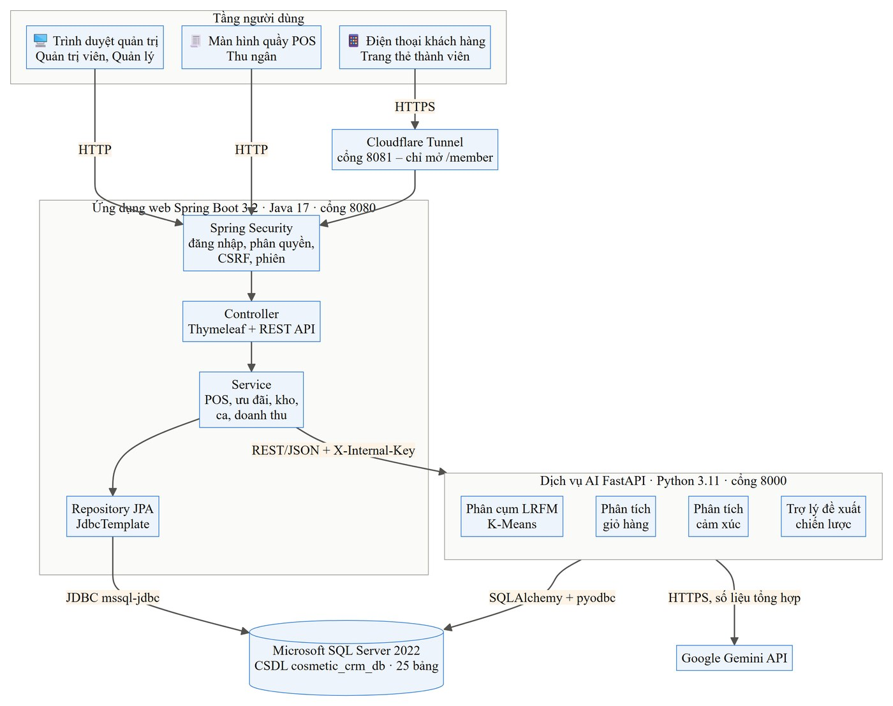

# Hướng dẫn cài đặt hệ thống

**Đề tài:** Xây dựng hệ thống phân tích và phân cụm khách hàng ứng dụng trí tuệ nhân tạo hỗ trợ đề xuất chiến lược kinh doanh
**Sinh viên thực hiện:** Nguyễn Thị Hà – MSSV 1250080047 – Lớp 12_ĐH_THMT
**Giảng viên hướng dẫn:** ThS. Lê Tuấn Thu

Tài liệu này hướng dẫn cài đặt hệ thống từ đầu trên một máy tính Windows: cài phần mềm cần thiết, cấu hình Microsoft SQL Server, tạo cơ sở dữ liệu, chạy hai dịch vụ và kiểm tra sau cài đặt. Cách sử dụng các chức năng xem ở [HUONG_DAN_SU_DUNG.md](HUONG_DAN_SU_DUNG.md).

---

## Mục lục

1. [Tổng quan kiến trúc](#1-tổng-quan-kiến-trúc)
2. [Yêu cầu phần cứng và phần mềm](#2-yêu-cầu-phần-cứng-và-phần-mềm)
3. [Cấu hình Microsoft SQL Server](#3-cấu-hình-microsoft-sql-server)
4. [Lấy mã nguồn](#4-lấy-mã-nguồn)
5. [Cấu hình kết nối (tệp .env)](#5-cấu-hình-kết-nối-tệp-env)
6. [Cài thư viện Python](#6-cài-thư-viện-python)
7. [Chuẩn bị dữ liệu](#7-chuẩn-bị-dữ-liệu)
8. [Tạo cơ sở dữ liệu trên SQL Server](#8-tạo-cơ-sở-dữ-liệu-trên-sql-server)
9. [Chạy hệ thống](#9-chạy-hệ-thống)
10. [Kiểm tra sau cài đặt và khởi tạo mô hình](#10-kiểm-tra-sau-cài-đặt-và-khởi-tạo-mô-hình)
11. [Tùy chọn: trợ lý AI Gemini](#11-tùy-chọn-trợ-lý-ai-gemini)
12. [Tùy chọn: mở trang thẻ thành viên cho điện thoại](#12-tùy-chọn-mở-trang-thẻ-thành-viên-cho-điện-thoại)
13. [Chạy kiểm thử tự động](#13-chạy-kiểm-thử-tự-động)
14. [Cập nhật, sao lưu và gỡ dữ liệu mô phỏng](#14-cập-nhật-sao-lưu-và-gỡ-dữ-liệu-mô-phỏng)
15. [Xử lý sự cố thường gặp](#15-xử-lý-sự-cố-thường-gặp)

---

## 1. Tổng quan kiến trúc

Hệ thống gồm **hai dịch vụ** dùng chung **một cơ sở dữ liệu Microsoft SQL Server**:



| Thành phần | Công nghệ | Cổng | Thư mục |
|---|---|---|---|
| Ứng dụng web (giao diện quản trị, quầy POS, thẻ thành viên, nghiệp vụ) | Java 17+, Spring Boot 3.2.5, Thymeleaf | **8080** (8081 cho trang thẻ thành viên khi mở ra Internet) | `frontend-pos/` |
| Dịch vụ AI (phân cụm LRFM – K-Means, gợi ý mua kèm, phân tích cảm xúc, trợ lý) | Python 3.11, FastAPI, scikit-learn | **8000** | `backend-pos/` |
| Cơ sở dữ liệu `cosmetic_crm_db` (25 bảng) | Microsoft SQL Server 2019/2022 | **1433** | `database/` |

Trình duyệt chỉ làm việc với Spring Boot. Spring Boot gọi dịch vụ AI kèm một khóa nội bộ (`X-Internal-Key`) do chính Spring Boot tạo ra trong thư mục `.runtime/` khi khởi động lần đầu.

---

## 2. Yêu cầu phần cứng và phần mềm

**Phần cứng tối thiểu:** CPU 4 nhân, RAM 8 GB (khuyến nghị 16 GB), ổ cứng trống khoảng 5 GB, Windows 10/11 64-bit.

| Phần mềm | Phiên bản | Bắt buộc | Ghi chú |
|---|---|---|---|
| Microsoft SQL Server | 2019 hoặc 2022 (Express / Developer đều được) | Có | <https://www.microsoft.com/sql-server/sql-server-downloads> |
| SQL Server Management Studio (SSMS) | Bản mới nhất | Khuyến nghị | Để xem bảng, chạy truy vấn, sao lưu. <https://learn.microsoft.com/sql/ssms/download-sql-server-management-studio-ssms> |
| **ODBC Driver 17 for SQL Server** | **17.x** | Có | Mã Python dùng đúng tên trình điều khiển này; chỉ cài bản 18 thì sẽ **không** kết nối được. <https://learn.microsoft.com/sql/connect/odbc/download-odbc-driver-for-sql-server> |
| Java JDK | 17 trở lên (đã chạy thử trên JDK 23) | Có | <https://adoptium.net> |
| Apache Maven | 3.9.x | Không bắt buộc | Có thể dùng `mvnw.cmd` có sẵn trong `frontend-pos/` thay cho Maven |
| Python | 3.11 | Có | Khi cài nhớ chọn **Add python.exe to PATH**. <https://www.python.org/downloads/> |
| Git | Bản mới nhất | Không bắt buộc | Để tải mã nguồn từ GitHub |
| Google Chrome / Microsoft Edge | Bản mới nhất | Có | Chạy giao diện; quét mã QR bằng camera |
| cloudflared | Bản mới nhất | Tùy chọn | Chỉ cần khi muốn khách mở thẻ thành viên bằng 4G (mục 12) |

Kiểm tra nhanh sau khi cài, mở **PowerShell** và chạy:

```powershell
java -version
python --version
mvn -v                      # bỏ qua nếu dùng mvnw.cmd
Get-OdbcDriver -Name "ODBC Driver 17 for SQL Server"
```

---

## 3. Cấu hình Microsoft SQL Server

Hai dịch vụ kết nối SQL Server bằng **tài khoản SQL (tên đăng nhập + mật khẩu)** qua **TCP cổng 1433**, nên cần làm ba việc sau.

### 3.1. Bật chế độ xác thực hỗn hợp (SQL Server and Windows Authentication)

1. Mở **SSMS**, đăng nhập bằng *Windows Authentication*.
2. Chuột phải vào tên máy chủ → **Properties** → **Security**.
3. Chọn **SQL Server and Windows Authentication mode** → **OK**.
4. Chuột phải vào tên máy chủ → **Restart** để áp dụng.

### 3.2. Tạo tài khoản đăng nhập cho ứng dụng

Có thể dùng tài khoản `sa` (bật và đặt mật khẩu trong **Security → Logins → sa**), hoặc tạo tài khoản riêng – khuyến nghị cách này. Mở **New Query** và chạy:

```sql
CREATE LOGIN crm_app WITH PASSWORD = N'DatMatKhauManhCuaBan@2026', CHECK_POLICY = ON;
ALTER SERVER ROLE dbcreator ADD MEMBER crm_app;   -- được phép tạo database cosmetic_crm_db
```

Tài khoản tạo ra database sẽ là chủ sở hữu (owner) của database đó, nên không cần cấp thêm quyền.

### 3.3. Bật TCP/IP cổng 1433

1. Mở **SQL Server Configuration Manager** (gõ tên này trong menu Start).
2. **SQL Server Network Configuration** → **Protocols for MSSQLSERVER** (hoặc tên instance của bạn) → chuột phải **TCP/IP** → **Enable**.
3. Mở **TCP/IP → Properties → IP Addresses**, kéo xuống mục **IPAll**: để trống *TCP Dynamic Ports*, đặt *TCP Port* = `1433`.
4. **SQL Server Services** → chuột phải **SQL Server (MSSQLSERVER)** → **Restart**.

> **Nếu dùng bản Express có tên instance `SQLEXPRESS`:** làm như trên với *Protocols for SQLEXPRESS* để instance lắng nghe cổng 1433. Khi đó ứng dụng Java vẫn dùng `localhost:1433`; còn tệp `.env` có thể để `DB_SERVER=localhost` (cổng mặc định) hoặc `DB_SERVER=localhost\SQLEXPRESS`.

---

## 4. Lấy mã nguồn

Sao chép thư mục dự án vào ổ đĩa, ví dụ `D:\CODING\cosmetic-crm-ai`, hoặc tải bằng Git:

```powershell
cd D:\CODING
git clone <địa-chỉ-kho-mã-nguồn> cosmetic-crm-ai
cd cosmetic-crm-ai
```

Cấu trúc thư mục chính:

```text
cosmetic-crm-ai/
├── backend-pos/      Dịch vụ AI FastAPI: clustering_service.py, basket_service.py, sentiment_service.py,
│                     assistant_service.py, main.py, requirements.txt, .env.example, tests/
├── frontend-pos/     Ứng dụng Spring Boot: src/main/java (controller, service, repository, entity, security),
│                     src/main/resources (templates, static, application.properties), pom.xml, mvnw.cmd
├── database/         schema.sql, migrations/001…008, build_database.py, migrate.py, seed_store_sales.py
├── data/             raw/OnlineSales.xlsx, prepare_dataset.py, category_rules.csv, product_names_vi.csv
├── scripts/          public-member.cmd (mở trang thẻ thành viên ra Internet)
├── docs/             Tài liệu hướng dẫn (thư mục này)
├── README.md         Mô tả kỹ thuật chi tiết
└── ADMIN_GUIDE.md    Hướng dẫn quản trị, phân quyền, đọc báo cáo
```

---

## 5. Cấu hình kết nối (tệp .env)

Cả hai dịch vụ cùng đọc **một tệp** `backend-pos\.env`. Tệp này chứa mật khẩu nên **không được đưa lên GitHub**; mỗi máy tự tạo từ tệp mẫu:

```powershell
cd D:\CODING\cosmetic-crm-ai
Copy-Item backend-pos\.env.example backend-pos\.env
notepad backend-pos\.env
```

Điền các giá trị:

| Biến | Ý nghĩa | Ví dụ |
|---|---|---|
| `DB_SERVER` | Máy chủ SQL Server | `localhost` |
| `DB_NAME` | Tên database | `cosmetic_crm_db` (giữ nguyên) |
| `DB_USER` | Tài khoản SQL ở mục 3.2 | `crm_app` |
| `DB_PASSWORD` | Mật khẩu tài khoản SQL | `DatMatKhauManhCuaBan@2026` |
| `BASE_REFERENCE_DATE` | Ngày tham chiếu của dữ liệu nền (không cần sửa) | để trống → mặc định `2021-01-12` |
| `GEMINI_API_KEY` | Khóa Google Gemini (tùy chọn, mục 11) | để trống nếu không dùng |
| `GEMINI_ALLOW_STORE_CONTEXT` | Cho phép gửi số liệu tổng hợp cho Gemini | `0` (tắt) hoặc `1` (bật) |
| `GEMINI_MODEL`, `GEMINI_FALLBACK_MODEL` | Tên mô hình Gemini chính / dự phòng | giữ như tệp mẫu |

Spring Boot đọc tệp này qua dòng `spring.config.import=optional:file:../backend-pos/.env[.properties]` trong `frontend-pos/src/main/resources/application.properties`. Vì đường dẫn là `../backend-pos/.env`, **luôn chạy Spring Boot từ trong thư mục `frontend-pos`**.

---

## 6. Cài thư viện Python

```powershell
cd D:\CODING\cosmetic-crm-ai
python -m pip install -r backend-pos\requirements.txt
```

Các thư viện chính: pandas 2.2.2, numpy 1.26.4, scikit-learn 1.5.0, fastapi 0.111.0, uvicorn 0.30.0, SQLAlchemy 2.0.30, pyodbc 5.3.0, openpyxl 3.1.2, google-genai, matplotlib.

> Khuyến nghị (không bắt buộc): tạo môi trường ảo trước khi cài để không ảnh hưởng các dự án Python khác:
> `python -m venv .venv` rồi `.\.venv\Scripts\Activate.ps1`.

---

## 7. Chuẩn bị dữ liệu

Dữ liệu nền là tệp `data\raw\OnlineSales.xlsx` (250.000 dòng giao dịch, 03/01/2020 – 11/01/2021) đi kèm sách *Essentials of Marketing Analytics* (Hair, Harrison, Ajjan – McGraw Hill). Chạy script làm sạch và chuyển đổi:

```powershell
python data\prepare_dataset.py
```

Script tạo thư mục `data\processed\` (categories, products, customers, orders, order_items) và báo cáo `data\processed\data_report.md`. Kết quả đúng là: **207.599 dòng, 13.637 hóa đơn, 3.263 khách hàng, 12.066 sản phẩm**. Tiền được quy đổi 1 USD = 25.600 đ; họ tên và số điện thoại khách hàng là dữ liệu **mô phỏng** (số dạng `0100xxxxxx`).

---

## 8. Tạo cơ sở dữ liệu trên SQL Server

```powershell
python database\build_database.py
```

Script sẽ (mất khoảng 4 phút):

1. Tạo database `cosmetic_crm_db` với collation `Vietnamese_CI_AS`.
2. Chạy `database\schema.sql` và các migration `database\migrations\001…008`.
3. Nạp dữ liệu đã chuẩn bị ở mục 7, in số dòng của từng bảng khi hoàn tất.

> ⚠️ **Lưu ý quan trọng**
> - Nếu database đã tồn tại, script dừng lại và báo *“Database cosmetic_crm_db đã tồn tại”*. Tùy chọn `--recreate` sẽ **xóa toàn bộ dữ liệu**, kể cả hóa đơn đã bán tại quầy. Chỉ dùng khi chắc chắn muốn làm lại từ đầu.
> - Với database **đang dùng**, khi cập nhật mã nguồn mới chỉ cần chạy `python database\migrate.py`. Các migration chỉ thêm bảng/cột, chạy lại nhiều lần vẫn an toàn, không xóa dữ liệu.
> - Script từ chối thao tác trên các database được bảo vệ (`master`, `msdb`, … và database của các project cũ).

**Tùy chọn – dữ liệu bán hàng tại quầy mô phỏng.** Tạo 50 hóa đơn mô phỏng (15/08 – 13/11/2026) để có số liệu minh họa cho ca làm việc, tích điểm, kiểm tra lệch:

```powershell
python database\seed_store_sales.py          # tạo (từ chối nếu đã có)
python database\seed_store_sales.py --undo   # gỡ sạch: trả hàng về lô, xóa điểm, hóa đơn, ca
```

---

## 9. Chạy hệ thống

Mở **hai cửa sổ PowerShell** và giữ cả hai cửa sổ mở trong lúc sử dụng.

**Cửa sổ 1 – Ứng dụng web Spring Boot (chạy trước):**

```powershell
cd D:\CODING\cosmetic-crm-ai\frontend-pos
mvn spring-boot:run
# hoặc nếu không cài Maven:
.\mvnw.cmd spring-boot:run
```

Lần chạy đầu Maven tải thư viện nên mất vài phút. Khi thấy dòng `Started PhanTichAiApplication`, ứng dụng đã sẵn sàng ở <http://localhost:8080>. Ở lần khởi động đầu, Spring Boot cũng:

- tạo khóa nội bộ `.runtime\ai-internal.key` dùng chung với dịch vụ AI;
- tạo các **tài khoản demo** nếu chưa có (xem mục 10).

**Cửa sổ 2 – Dịch vụ AI FastAPI:**

```powershell
cd D:\CODING\cosmetic-crm-ai\backend-pos
python -X utf8 -m uvicorn main:app --port 8000
```

Thấy dòng `Application startup complete.` là dịch vụ đã chạy. Tham số `-X utf8` giúp hiển thị đúng tiếng Việt trên cửa sổ dòng lệnh.

> Nếu chạy FastAPI trước Spring Boot, dịch vụ AI vẫn khởi động nhưng trả lỗi 503 *“Start the Spring application to initialize the internal AI key”* cho tới khi Spring Boot tạo xong khóa. Chỉ cần bật Spring Boot là hết.
>
> Muốn dừng: bấm `Ctrl + C` trong từng cửa sổ.

---

## 10. Kiểm tra sau cài đặt và khởi tạo mô hình

1. Mở trình duyệt, vào **<http://localhost:8080/login>**.
2. Đăng nhập bằng tài khoản demo:

   | Tài khoản | Mật khẩu | Vai trò | Dùng để |
   |---|---|---|---|
   | `admin` | `123456` | Quản trị viên | Toàn quyền, quản lý tài khoản |
   | `manager` | `123456` | Quản lý | Mô hình phân cụm, ưu đãi, báo cáo, ca làm việc |
   | `nhanvien1`, `nhanvien2`, `nhanvien3` | `123456` | Thu ngân | Bán hàng tại quầy POS theo ca |

   > Tài khoản demo chỉ dùng cho buổi báo cáo. Khi dùng thật, đặt `app.demo-accounts.enabled=false` trong `application.properties` và đổi mật khẩu (tài khoản tạo mới phải có mật khẩu từ 10 ký tự).

3. Trên trang **Tổng quan**, dòng trạng thái phải hiện *“Đã đọc dữ liệu SQL Server”* và các ô số liệu có giá trị (khoảng 13.6xx hóa đơn, 3.26x khách hàng, 200 sản phẩm đang bán).
4. **Khởi tạo mô hình phân cụm lần đầu** (chỉ làm một lần với database mới):
   - Vào **Mô hình phân cụm** → mục *Huấn luyện mô hình* → chọn nguồn **Chỉ dữ liệu nền (OnlineSales)**.
   - Chọn số nhóm (hệ thống gợi ý **3**) → bấm **Xem trước**.
   - Nhập lý do, ví dụ “Mô hình nền v1” → bấm **Áp dụng phiên bản này**.
5. Vào **Chiến lược ưu đãi**, điền ưu đãi cho từng nhóm khách (hoặc hỏi **Trợ lý phân tích**), đánh dấu **Bật ưu đãi cho quầy POS** → **Lưu thay đổi**.
6. Mở **<http://localhost:8080/pos>**, tra cứu thử khách `0100027362` hoặc mã `KH27362`: POS phải hiện nhóm khách và ưu đãi tương ứng.

Nếu cả 6 bước đều chạy được, hệ thống đã cài đặt thành công.

---

## 11. Tùy chọn: trợ lý AI Gemini

Trợ lý phân tích trên trang quản trị có thể gọi Google Gemini để soạn đề xuất chiến lược.

1. Lấy khóa API tại <https://aistudio.google.com> (tài khoản Google).
2. Trong `backend-pos\.env`: điền `GEMINI_API_KEY=<khóa của bạn>` và đặt `GEMINI_ALLOW_STORE_CONTEXT=1`.
3. Khởi động lại dịch vụ FastAPI.

Gemini **chỉ nhận số liệu tổng hợp** (LRFM theo nhóm, phiên bản mô hình, số khách theo nhóm, sản phẩm bán chạy, ưu đãi hiện có), **không nhận tên hay số điện thoại khách**. Nếu không cấu hình khóa hoặc để `GEMINI_ALLOW_STORE_CONTEXT=0`, hệ thống vẫn chạy bình thường; trợ lý trả lời dựa trên số liệu nội bộ và không gọi dịch vụ bên ngoài.

---

## 12. Tùy chọn: mở trang thẻ thành viên cho điện thoại

Khách hàng dùng trang **`/member`** trên điện thoại. Ở quầy POS, nút **📱 Thẻ thành viên** hiện mã QR của địa chỉ phù hợp nhất.

| Cách | Khách dùng mạng | Cần làm |
|---|---|---|
| Chung Wi-Fi | Cùng Wi-Fi với máy tính chạy hệ thống | Không cần làm gì; hệ thống tự lấy địa chỉ dạng `http://192.168.x.x:8080/member` |
| Qua Internet | 4G hoặc Wi-Fi bất kỳ | Cài một lần: `winget install --id Cloudflare.cloudflared -e`. Mỗi lần dùng: bấm đúp `scripts\public-member.cmd` và giữ cửa sổ mở. Địa chỉ `https://….trycloudflare.com/member` đổi mỗi lần bật |
| Địa chỉ cố định | 4G hoặc Wi-Fi bất kỳ | Có tên miền và Cloudflare Tunnel có tên → đặt `member.public-url` trong `application.properties` |

Đường hầm chỉ nối vào **cổng 8081**. Cổng này chỉ nhận kết nối từ chính máy tính và **chỉ mở trang thẻ thành viên**; trang quản trị, POS và đăng nhập nhân viên đều trả về 404 từ Internet. Muốn tắt hẳn cổng này: đặt `member.public-port=-1`.

> Trình duyệt chỉ cho POS dùng camera để quét mã QR khi mở bằng `http://localhost:8080` hoặc HTTPS.

---

## 13. Chạy kiểm thử tự động

```powershell
cd D:\CODING\cosmetic-crm-ai\backend-pos
python -X utf8 -m unittest discover -s tests -v     # 41 kiểm thử dịch vụ AI

cd ..\frontend-pos
mvn test                                            # 151 kiểm thử Spring Boot (22 kiểm thử tích hợp tự bỏ qua)
```

Kiểm thử tích hợp **chỉ đọc** trên SQL Server thật (cần Spring Boot và FastAPI đang chạy; thao tác ghi chạy trong giao dịch và được hoàn tác):

```powershell
cd D:\CODING\cosmetic-crm-ai\frontend-pos
$env:POS_READ_ONLY_QA="1"; mvn test
$env:POS_BROWSER_QA="1"; mvn test -Dtest=GrowthIntegrationTest     # thêm kiểm thử giao diện bằng Chrome
Remove-Item Env:POS_READ_ONLY_QA; Remove-Item Env:POS_BROWSER_QA
```

---

## 14. Cập nhật, sao lưu và gỡ dữ liệu mô phỏng

| Việc | Lệnh / thao tác |
|---|---|
| Cập nhật database đang dùng sau khi lấy mã mới | `python database\migrate.py` |
| Sao lưu database | SSMS → chuột phải `cosmetic_crm_db` → **Tasks → Back Up…**, hoặc chạy T-SQL: `BACKUP DATABASE cosmetic_crm_db TO DISK = N'D:\backup\cosmetic_crm_db.bak';` |
| Khôi phục | SSMS → chuột phải **Databases → Restore Database…** → chọn tệp `.bak` |
| Gỡ 50 hóa đơn mô phỏng | `python database\seed_store_sales.py --undo` |
| Tạo lại database từ đầu (**mất toàn bộ dữ liệu**) | `python database\build_database.py --recreate` |

---

## 15. Xử lý sự cố thường gặp

| Hiện tượng | Nguyên nhân | Cách xử lý |
|---|---|---|
| `Data source name not found…` hoặc `Can't open lib 'ODBC Driver 17 for SQL Server'` | Chưa cài ODBC Driver 17 (hoặc chỉ có bản 18) | Cài **ODBC Driver 17 for SQL Server** (mục 2) |
| `Login failed for user '…'` | Chưa bật xác thực hỗn hợp, sai mật khẩu trong `.env`, tài khoản bị tắt | Làm lại mục 3.1, 3.2; kiểm tra `DB_USER`, `DB_PASSWORD` |
| Spring Boot báo `The TCP/IP connection to the host localhost, port 1433 has failed` | SQL Server chưa bật TCP/IP hoặc không nghe cổng 1433 | Làm lại mục 3.3 và khởi động lại dịch vụ SQL Server |
| `Chưa có data/processed. Chạy python data/prepare_dataset.py trước.` | Chưa chuẩn bị dữ liệu | Chạy mục 7 trước mục 8 |
| `Database cosmetic_crm_db đã tồn tại` | Database đã được tạo trước đó | Dùng `migrate.py`; chỉ dùng `--recreate` khi muốn xóa làm lại |
| Spring Boot báo thiếu `DB_PASSWORD` / không kết nối được | Chạy `mvn` không đứng trong thư mục `frontend-pos`, nên không tìm thấy `../backend-pos/.env` | `cd frontend-pos` rồi mới chạy |
| `Port 8080 (8081, 8000) was already in use` | Có chương trình khác (hoặc một phiên cũ) đang dùng cổng | `netstat -ano \| findstr :8080` để xem PID, đóng chương trình đó hoặc tắt cửa sổ phiên cũ |
| Dịch vụ AI trả 503 *“Start the Spring application…”* | Spring Boot chưa chạy nên chưa có khóa nội bộ | Bật Spring Boot (mục 9) |
| Trang quản trị báo *“Chưa có mô hình phân cụm”* | Database mới, chưa tạo phiên bản mô hình | Làm bước 4 ở mục 10 |
| POS không áp dụng ưu đãi nhóm | Dịch vụ AI tắt, hoặc chiến lược chưa bật | Kiểm tra cửa sổ FastAPI; vào **Chiến lược ưu đãi** đánh dấu **Bật ưu đãi cho quầy POS**. POS vẫn bán hàng bình thường khi dịch vụ AI tạm dừng |
| Cửa sổ dòng lệnh báo `UnicodeEncodeError` | Bảng mã tiếng Việt của console | Chạy Python với `-X utf8` |
| Camera POS không mở | Trình duyệt chặn camera trên địa chỉ không an toàn | Mở POS bằng `http://localhost:8080/pos`; cấp quyền camera cho trang |
| Trợ lý AI báo lỗi gọi Gemini | Sai khóa, hết hạn mức, mất mạng | Kiểm tra `GEMINI_API_KEY`, kết nối Internet; các chức năng khác không bị ảnh hưởng |

Tài liệu kỹ thuật chi tiết hơn: [README.md](../README.md) và [ADMIN_GUIDE.md](../ADMIN_GUIDE.md).
