# Hướng dẫn sử dụng hệ thống

**Đề tài:** Xây dựng hệ thống phân tích và phân cụm khách hàng ứng dụng trí tuệ nhân tạo hỗ trợ đề xuất chiến lược kinh doanh
**Sinh viên thực hiện:** Nguyễn Thị Hà – MSSV 1250080047 – Lớp 12_ĐH_THMT
**Giảng viên hướng dẫn:** ThS. Lê Tuấn Thu

Tài liệu hướng dẫn sử dụng các chức năng của hệ thống theo từng vai trò. Cách cài đặt xem ở [HUONG_DAN_CAI_DAT.md](HUONG_DAN_CAI_DAT.md). Ảnh minh họa được chụp từ hệ thống đang chạy trên CSDL Microsoft SQL Server của đề tài; tên và số điện thoại khách hàng là dữ liệu mô phỏng.

---

## Mục lục

1. [Giới thiệu và phân quyền](#1-giới-thiệu-và-phân-quyền)
2. [Đăng nhập, đăng xuất](#2-đăng-nhập-đăng-xuất)
3. [Dành cho Quản lý và Quản trị viên – trang quản trị](#3-dành-cho-quản-lý-và-quản-trị-viên--trang-quản-trị)
4. [Dành cho Thu ngân – quầy bán hàng POS](#4-dành-cho-thu-ngân--quầy-bán-hàng-pos)
5. [Dành cho Khách hàng – trang thẻ thành viên](#5-dành-cho-khách-hàng--trang-thẻ-thành-viên)
6. [Kịch bản demo khi báo cáo với GVHD](#6-kịch-bản-demo-khi-báo-cáo-với-gvhd)
7. [Câu hỏi thường gặp](#7-câu-hỏi-thường-gặp)

---

## 1. Giới thiệu và phân quyền

Hệ thống mô phỏng một **cửa hàng bán lẻ mỹ phẩm** có bán hàng tại quầy. Dữ liệu bán hàng được lưu vào SQL Server, mô hình AI chia khách hàng thành các nhóm theo hành vi mua sắm (**LRFM**: thời gian gắn bó, lần mua gần nhất, tần suất, chi tiêu) bằng thuật toán **K-Means**. Mỗi nhóm có một chiến lược ưu đãi, được áp dụng tự động khi thu ngân tính tiền.

Có ba không gian làm việc:

| Không gian | Địa chỉ | Người dùng |
|---|---|---|
| Trang quản trị | `http://localhost:8080/admin` | Quản lý, Quản trị viên |
| Quầy bán hàng POS | `http://localhost:8080/pos` | Mọi nhân viên (chủ yếu Thu ngân) |
| Thẻ thành viên | `http://localhost:8080/member` (mở trên điện thoại) | Khách hàng |

Quyền của từng vai trò nhân viên:

| Chức năng | Quản trị viên (ADMIN) | Quản lý (MANAGER) | Thu ngân (CASHIER) |
|---|:-:|:-:|:-:|
| Bán hàng, tra cứu và đăng ký khách, áp dụng ưu đãi đã duyệt | ✔ | ✔ | ✔ |
| Xem doanh thu, hóa đơn, khách hàng, tồn kho | ✔ | ✔ | — |
| Cập nhật sản phẩm, danh mục; nhập / xuất hủy kho | ✔ | ✔ | — |
| Sửa, bật/tắt ưu đãi; dùng trợ lý AI | ✔ | ✔ | — |
| Huấn luyện, áp dụng mô hình phân cụm; kiểm tra lệch dữ liệu | ✔ | ✔ | — |
| Xác nhận chênh lệch tiền mặt cuối ca | ✔ | ✔ | — |
| Tạo, khóa tài khoản; đổi vai trò; đặt lại mật khẩu | ✔ | — | — |

Quyền được kiểm tra ở máy chủ cho cả trang và API. Phiên làm việc tự hết hạn sau **30 phút** không thao tác.

---

## 2. Đăng nhập, đăng xuất

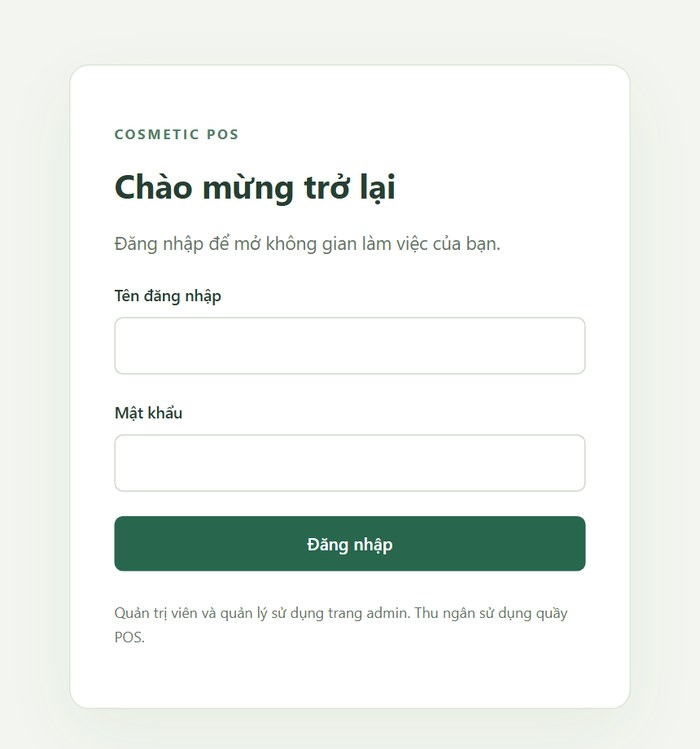

1. Mở `http://localhost:8080/login`.
2. Nhập **Tên đăng nhập** và **Mật khẩu** → **Đăng nhập**.
   - Quản trị viên, Quản lý được chuyển tới **trang quản trị**; Thu ngân được chuyển tới **quầy POS**.
   - Tài khoản demo: `admin`, `manager`, `nhanvien1`…`nhanvien3`, mật khẩu `123456`.
3. Đăng xuất: bấm **Đăng xuất** ở góc phải phía trên.

---

## 3. Dành cho Quản lý và Quản trị viên – trang quản trị

Thanh bên trái có 13 mục: **Tổng quan, Mô hình phân cụm, Chiến lược ưu đãi, Hiệu quả ưu đãi, Gợi ý mua kèm, Đánh giá của khách, Lịch sử hóa đơn, Doanh thu & so sánh, Sản phẩm & tồn kho, Kho & hạn dùng, Khách hàng, Ca làm việc, Tài khoản & quyền** (mục cuối chỉ Quản trị viên thấy). Ở góc trên có nút **Làm mới** (tải lại số liệu) và **Mở quầy POS**. Nút nổi **Trợ lý phân tích** ở góc phải dưới mở khung trò chuyện với trợ lý AI.

### 3.1. Tổng quan kinh doanh

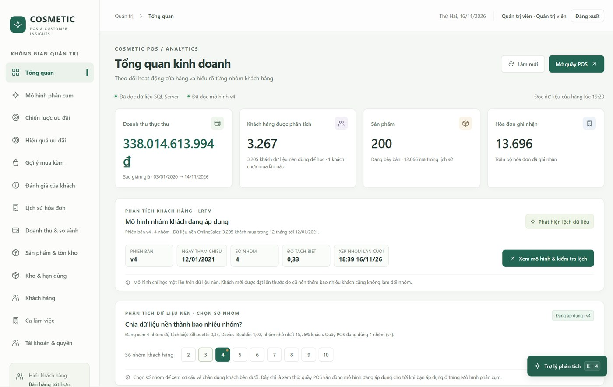

- **Thẻ số liệu:** doanh thu thực thu, số khách được phân tích, số sản phẩm đang bày bán, số hóa đơn.
- **Mô hình nhóm khách đang áp dụng:** phiên bản, ngày tham chiếu, số nhóm, độ tách biệt (Silhouette), lần xếp nhóm cuối. Nút **Xem mô hình & kiểm tra lệch** chuyển sang mục 3.2.
- **Chia dữ liệu nền thành bao nhiêu nhóm?** Bấm các số **2…10** để *xem thử* cơ cấu và chân dung khách của từng cách chia. Thao tác này **không ghi gì vào CSDL**; quầy POS vẫn dùng mô hình đang áp dụng. Muốn dùng thật cách chia đang xem thì bấm **Áp dụng K nhóm…**, hệ thống chuyển sang trang Mô hình phân cụm để xem trước và áp dụng.

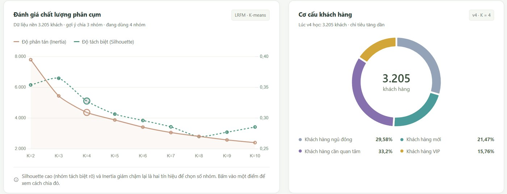

- **Đánh giá chất lượng phân cụm:** đường Inertia (phương pháp Elbow) và đường Silhouette theo số nhóm; bấm vào một điểm trên biểu đồ để xem cách chia đó.
- **Cơ cấu khách hàng** và bảng **Chân dung từng phân khúc:** số khách lúc học, tỷ trọng, số khách hôm nay, chi tiêu trung bình 12 tháng, số đơn, số ngày chưa mua và mô tả khách điển hình.

### 3.2. Mô hình phân cụm, kiểm tra lệch và huấn luyện lại

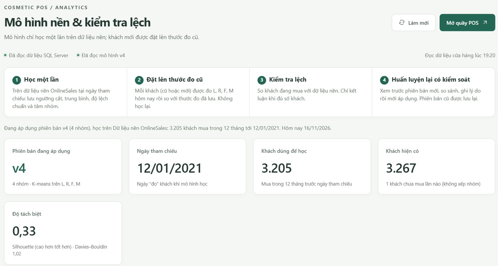

Mô hình **chỉ học khi bấm Áp dụng một phiên bản**. Khách mới chỉ được *đặt lên thước đo cũ*, nên thêm bao nhiêu khách cũng không làm các nhóm bị trôi.

**a) Đọc thước đo và kiểm tra lệch dữ liệu**

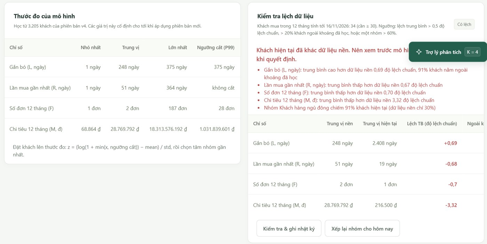

- Bảng **Thước đo của mô hình**: nhỏ nhất, trung vị, lớn nhất và ngưỡng cắt P99 của từng chỉ số L, R, F, M mà mô hình đã học.
- Khung **Kiểm tra lệch dữ liệu** so khách mua trong 12 tháng gần đây với dữ liệu huấn luyện. Hệ thống báo *có lệch* khi trung bình lệch quá 0,5 độ lệch chuẩn, hoặc hơn 20% khách nằm ngoài khoảng đã học, hoặc một nhóm chiếm hơn 60% khách; cần ít nhất 30 khách mới kết luận.
  - **Kiểm tra & ghi nhật ký:** lưu kết quả kiểm tra vào bảng `drift_checks`.
  - **Xếp lại nhóm cho hôm nay:** xếp lại nhóm cho mọi khách ngay (hệ thống cũng tự làm việc này mỗi ngày một lần).
- Kiểm tra lệch **không bao giờ tự huấn luyện lại**; nó chỉ đưa ra khuyến nghị để người quản lý quyết định.

**b) Huấn luyện và áp dụng phiên bản mới**

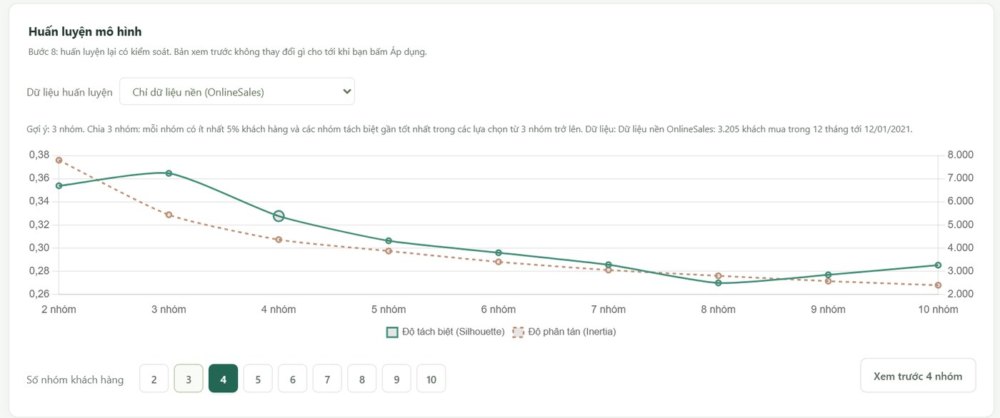

1. Chọn **Dữ liệu huấn luyện**: *Chỉ dữ liệu nền (OnlineSales)* hoặc *Dữ liệu nền + khách mua 12 tháng gần đây* (dùng khi đã phát hiện lệch).
2. Xem biểu đồ Silhouette / Inertia và dòng **Gợi ý** số nhóm (hệ thống ưu tiên ≥ 3 nhóm, mỗi nhóm ≥ 5% khách, Silhouette cao nhất).
3. Chọn số nhóm → bấm **Xem trước**. Bản xem trước hiển thị chất lượng cũ/mới, thước đo cũ/mới, các nhóm mới và **ma trận chuyển nhóm** (khách của nhóm cũ sang nhóm mới). Lúc này **chưa ghi gì vào CSDL**.
4. Nhập **Lý do** → bấm **Áp dụng phiên bản này**. Hệ thống lưu phiên bản mới (v2, v3…), chuyển phiên bản cũ sang trạng thái lưu trữ (không xóa), xếp lại mọi khách và đồng bộ ưu đãi:
   - Nhóm mới trùng ít nhất 60% thành viên với một nhóm cũ thì **giữ ưu đãi đã duyệt**.
   - Nhóm khác nhận ưu đãi nháp 0% **đang tắt** để bạn điền lại; ưu đãi cũ được lưu vào lịch sử.

**c) Lịch sử phiên bản**

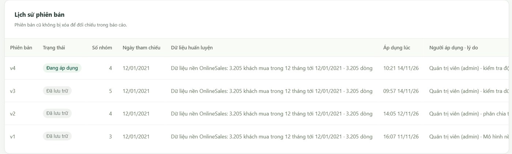

Mọi phiên bản (người áp dụng, thời điểm, số nhóm, lý do) đều được giữ để đối chiếu.

### 3.3. Chiến lược ưu đãi và trợ lý AI

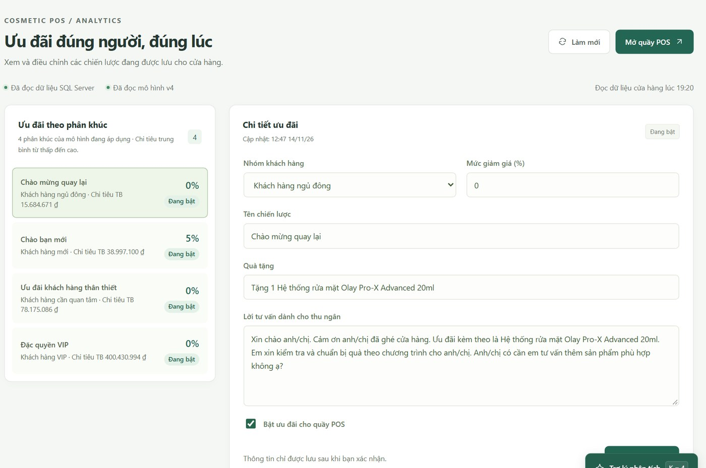

1. Ở cột **Ưu đãi theo phân khúc**, chọn một nhóm khách (sắp theo chi tiêu trung bình tăng dần).
2. Ở khung **Chi tiết ưu đãi**, điền:
   - **Tên chiến lược**, ví dụ “Chào mừng quay lại”.
   - **Mức giảm giá (%)**: 0 nếu chỉ tặng quà.
   - **Quà tặng**: nên là sản phẩm đang bán và còn hàng để thu ngân chọn được tại quầy.
   - **Lời tư vấn dành cho thu ngân**: câu thu ngân nói với khách.
3. Đánh dấu **Bật ưu đãi cho quầy POS** → **Lưu thay đổi**. Thông tin chỉ được lưu sau khi bạn xác nhận.

**Hỏi trợ lý AI:** bấm **Trợ lý phân tích** và hỏi bằng tiếng Việt, ví dụ *“Đề xuất ưu đãi giữ chân nhóm khách hàng cần quan tâm”*. Trợ lý dựa trên số liệu tổng hợp của từng nhóm, sản phẩm đang bán và ưu đãi hiện có. Đề xuất được kiểm tra (đúng nhóm, quà có trong kho); trợ lý **không tự lưu hay bật** ưu đãi, bạn xem lại rồi tự lưu.

> Khi **bật** một chiến lược, hệ thống tự giữ khoảng **10% khách của nhóm làm nhóm đối chứng** (không nhận ưu đãi) để đo hiệu quả (mục 3.4). **Tắt** chiến lược là kết thúc lần đo.

### 3.4. Hiệu quả ưu đãi

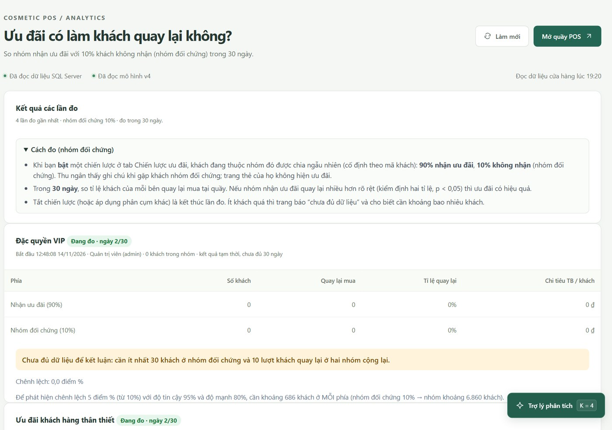

- Mỗi chiến lược đang bật là một **lần đo**. Bảng so sánh hai phía *Nhận ưu đãi (90%)* và *Nhóm đối chứng (10%)*: số khách, số quay lại mua tại quầy, tỷ lệ quay lại, chi tiêu trung bình.
- Sau **30 ngày**, hệ thống dùng kiểm định z để kết luận bằng lời: *có hiệu quả / chưa thấy khác biệt / làm giảm / chưa đủ dữ liệu*. Cần ít nhất 30 khách đối chứng và 10 lượt quay lại.
- Khung **Mô phỏng** (ghi rõ *“MÔ PHỎNG – không phải dữ liệu thật”*): nhập số khách, tỷ lệ quay lại giả định → **Chạy mô phỏng** để xem một lần đo trông như thế nào. Không lưu gì vào CSDL.

### 3.5. Gợi ý mua kèm

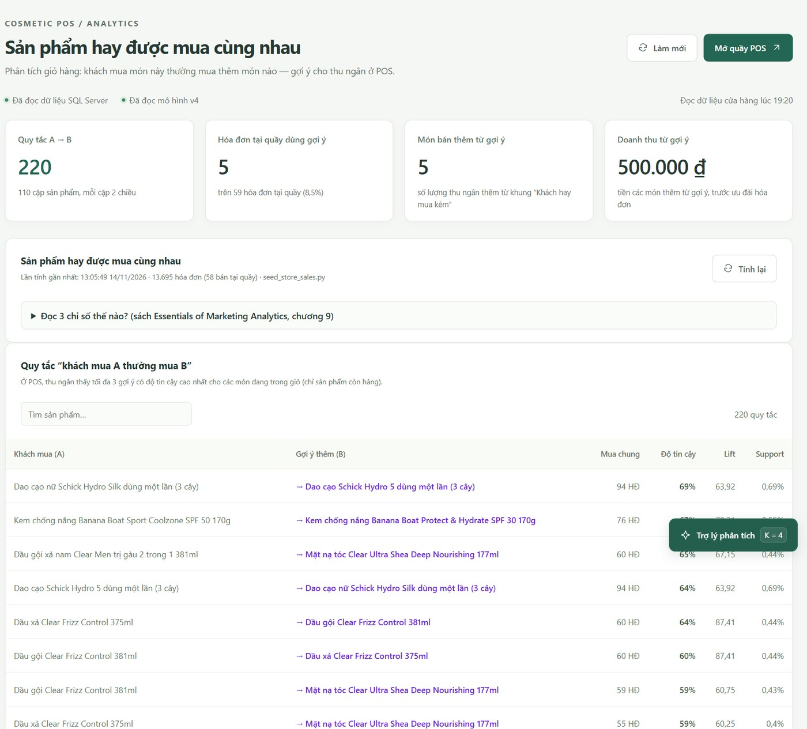

- Bảng **Quy tắc “khách mua A thường mua B”** với các chỉ số: số hóa đơn mua chung, độ tin cậy (confidence), lift, support. Ví dụ: *Dầu xả Clear Frizz Control → Dầu gội Clear Frizz Control*, confidence 65%, lift 89,9.
- Các thẻ phía trên cho biết bao nhiêu hóa đơn tại quầy đã dùng gợi ý, số món bán thêm và doanh thu từ gợi ý.
- Bấm **Tính lại** sau khi có thêm nhiều hóa đơn để cập nhật quy tắc.

### 3.6. Đánh giá của khách

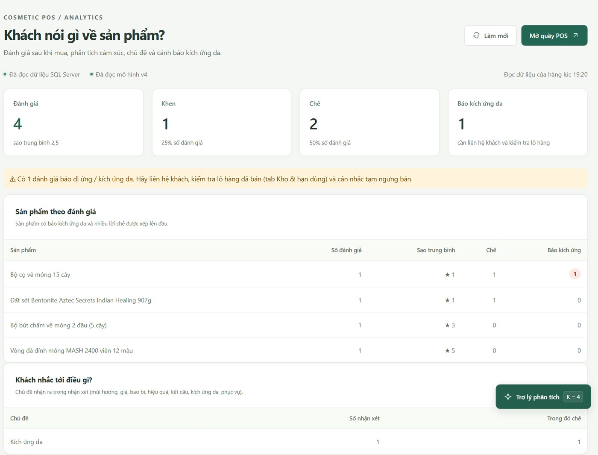

- Số liệu khen / chê / báo kích ứng da; **cảnh báo kích ứng da luôn hiện đầu tiên** (nên liên hệ khách và kiểm tra lô hàng đã bán).
- **Sản phẩm theo đánh giá**, **Khách nhắc tới điều gì?** (chủ đề: mùi hương, giá, bao bì, hiệu quả, kết cấu, kích ứng da, phục vụ).
- Danh sách nhận xét: lọc theo loại; bấm **Ẩn** để ẩn nhận xét không phù hợp (**Hiện lại** để khôi phục).
- Nếu dịch vụ AI tắt lúc khách gửi đánh giá, bấm **Phân tích đánh giá còn chờ** sau khi dịch vụ chạy lại.

### 3.7. Lịch sử hóa đơn

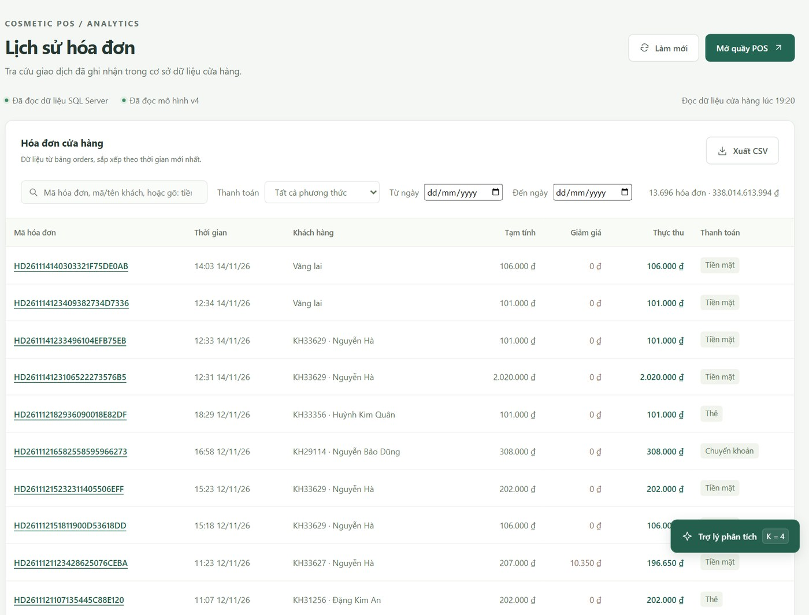

- Lọc theo **Thanh toán** (Tiền mặt, Chuyển khoản, Thẻ, Trực tuyến), **Từ ngày – Đến ngày**; ô tìm kiếm nhận mã hóa đơn, mã/tên/SĐT khách.
- Bấm vào **mã hóa đơn** để xem dòng hàng, quà tặng giá 0, thu ngân và ca.
- **Xuất CSV** để tải danh sách đang lọc.

### 3.8. Doanh thu và so sánh

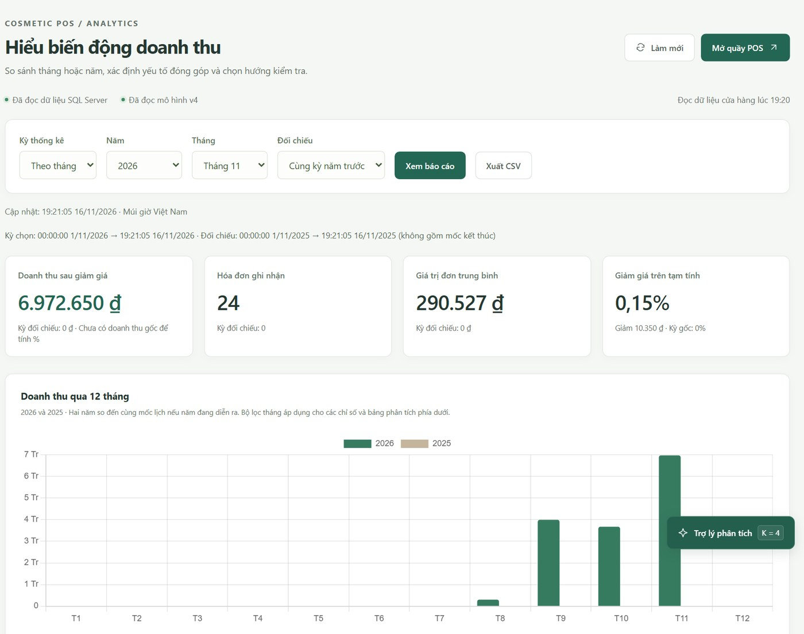

1. Chọn **Kỳ thống kê**, **Năm**, **Tháng** và **Đối chiếu** (kỳ trước hoặc cùng kỳ năm trước) → **Xem báo cáo**.
2. Đọc các thẻ: doanh thu sau giảm giá, số hóa đơn, giá trị đơn trung bình, tỷ lệ giảm giá; biểu đồ 12 tháng so với năm trước; đóng góp theo nhóm hàng; phương thức thanh toán; 10 sản phẩm có doanh số cao nhất.
3. Cuối trang là khung **Lợi nhuận gộp** của hóa đơn bán tại quầy (doanh thu thực thu trừ giá vốn của đúng lô hàng đã bán).
4. **Xuất CSV** để lưu báo cáo.

### 3.9. Sản phẩm và tồn kho

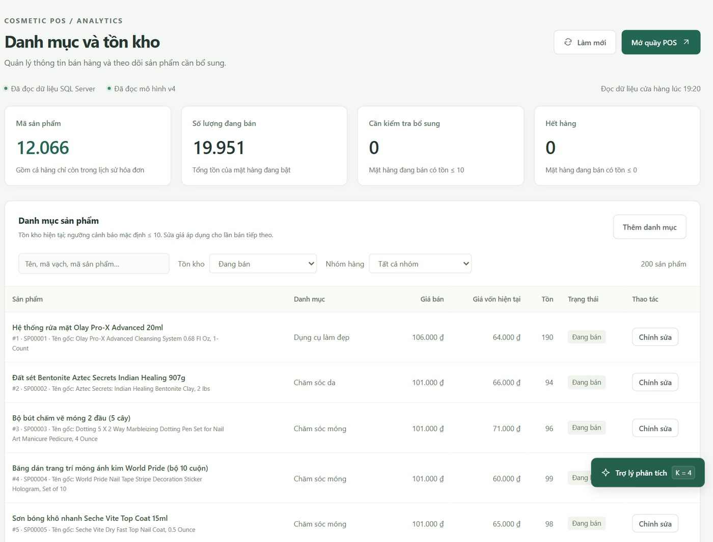

- Tìm theo tên, mã sản phẩm; lọc **Tồn kho** (hết hàng, tồn thấp ≤ 10, ngừng bán) và **Nhóm hàng**.
- **Chỉnh sửa** một sản phẩm: tên, mã, danh mục, giá bán, giá vốn, bật/tắt bán tại POS.
- **Thêm danh mục** để tạo nhóm hàng mới.
- Số tồn kho chỉ xem ở đây; thay đổi tồn phải qua phiếu nhập hoặc xuất hủy (mục 3.10).

### 3.10. Kho theo lô và hạn sử dụng

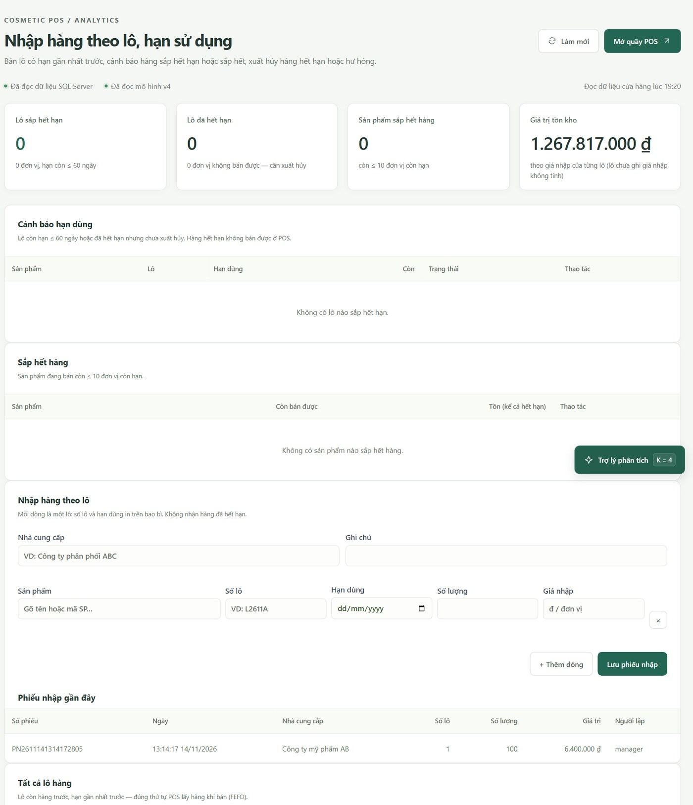

- **Cảnh báo hạn dùng:** lô còn ≤ 60 ngày hoặc đã hết hạn. **Sắp hết hàng:** sản phẩm còn ≤ 10 đơn vị bán được.
- **Nhập hàng theo lô:** điền **Nhà cung cấp**, **Ghi chú**; mỗi dòng gồm **Sản phẩm, Số lô, Hạn dùng, Số lượng, Giá nhập**; bấm **+ Thêm dòng** để nhập nhiều sản phẩm → **Lưu phiếu nhập**. Hệ thống không nhận hàng đã hết hạn.
- **Xuất hủy** một lô hết hạn hoặc hư hỏng: bấm **Xuất hủy** ở dòng lô, ghi lý do.
- Khi bán, hệ thống tự lấy **lô có hạn gần nhất trước** (FEFO) và ghi lại mỗi dòng hóa đơn lấy từ lô nào.

### 3.11. Khách hàng

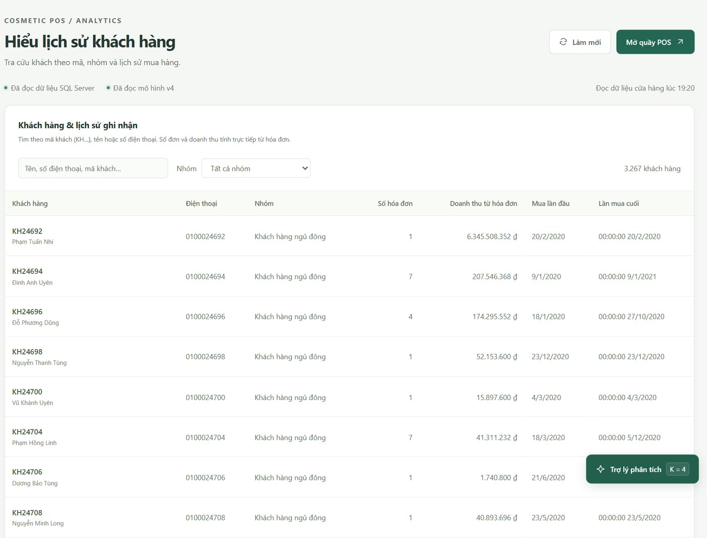

Tìm theo mã khách (`KH…`), tên hoặc số điện thoại; lọc theo **nhóm**; xem số đơn, doanh thu, ngày mua đầu và lần mua cuối. Khách chưa mua lần nào hiện *“Chưa mua hàng”*.

### 3.12. Ca làm việc và đối soát tiền mặt

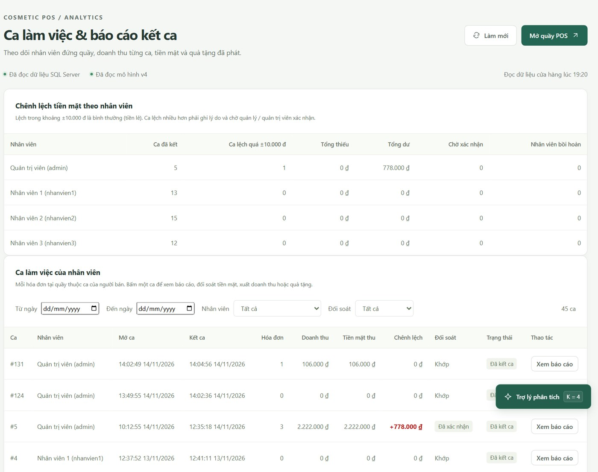

- Bảng **Chênh lệch tiền mặt theo nhân viên:** số ca lệch quá ±10.000 đ, tổng thiếu, tổng dư, ca chờ xác nhận, số lần bồi hoàn.
- Danh sách ca: lọc theo ngày, nhân viên, trạng thái **Đối soát**; **Xem báo cáo** của từng ca (in, xuất CSV doanh thu và quà tặng).
- Ca có trạng thái **Chờ xác nhận** (lệch quá ±10.000 đ): bấm **Đối soát** để
  1. sửa phương thức thanh toán nếu thu ngân bấm nhầm (ví dụ khách chuyển khoản nhưng bấm tiền mặt); hệ thống lưu lịch sử sửa và tính lại chênh lệch;
  2. chọn cách xử lý phần chênh lệch còn lại: *nhân viên bồi hoàn*, *cửa hàng chịu*, *nộp vào quỹ*, hoặc *đã tìm ra nguyên nhân và sửa*; ghi chú → **Xác nhận**.
- Nhân viên quên kết ca thì quản lý bấm **Kết ca thay**.

### 3.13. Tài khoản và quyền (chỉ Quản trị viên)

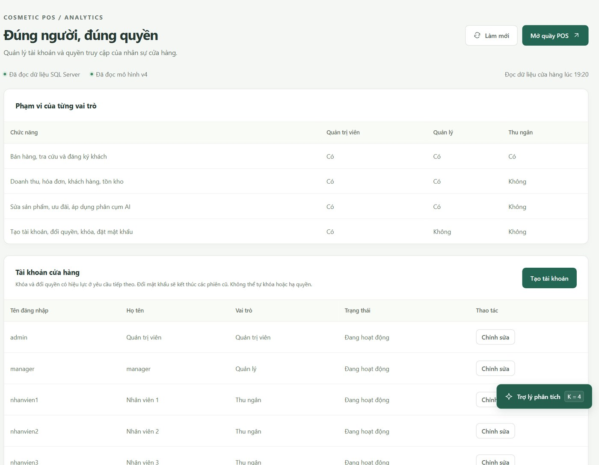

- **Tạo tài khoản:** tên đăng nhập, họ tên, vai trò, mật khẩu (**ít nhất 10 ký tự**).
- **Chỉnh sửa:** khóa / mở khóa, đổi vai trò, đặt lại mật khẩu. Thay đổi có hiệu lực ngay ở thao tác tiếp theo của người đó; đổi mật khẩu sẽ đăng xuất các phiên cũ.
- Không thể tự khóa hoặc hạ quyền chính mình; hệ thống luôn giữ ít nhất một Quản trị viên đang hoạt động. Dùng **khóa** thay cho xóa để giữ liên kết với hóa đơn cũ.

---

## 4. Dành cho Thu ngân – quầy bán hàng POS

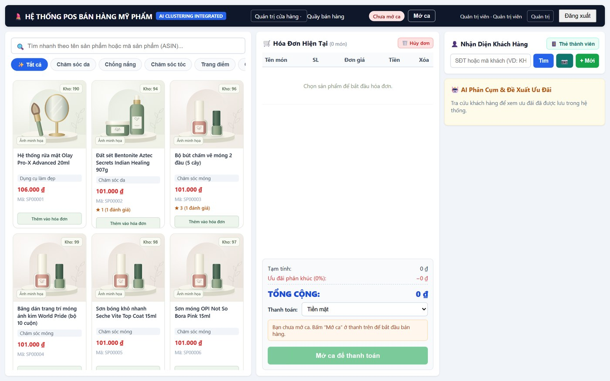

Màn hình gồm ba cột: **danh mục sản phẩm** (trái), **hóa đơn hiện tại** (giữa), **nhận diện khách hàng và ưu đãi AI** (phải). Thanh trên cùng hiển thị trạng thái ca và các nút ca làm việc.

### 4.1. Mở ca

1. Bấm **Mở ca** (hoặc hộp thoại tự hiện khi chưa có ca).
2. Nhập **tiền mặt đầu ca trong két** → **Bắt đầu ca**.

Chưa mở ca thì không thanh toán được (bấm **Để sau** nếu chỉ muốn xem). Mỗi hóa đơn được ghi vào ca và tên thu ngân đang đứng quầy.

### 4.2. Thêm sản phẩm vào hóa đơn

- Gõ tên hoặc mã sản phẩm vào ô tìm kiếm, hoặc lọc theo nhóm hàng (**✨ Tất cả**, Chăm sóc da, Chống nắng, …).
- Bấm vào thẻ sản phẩm hoặc **Thêm vào hóa đơn**. Thẻ hiển thị giá, số lượng **còn hạn bán được** và điểm đánh giá trung bình.
- Ở hóa đơn: dùng **−/+** để đổi số lượng, **×** để xóa dòng; **Hủy đơn** để làm lại từ đầu.

### 4.3. Nhận diện khách hàng

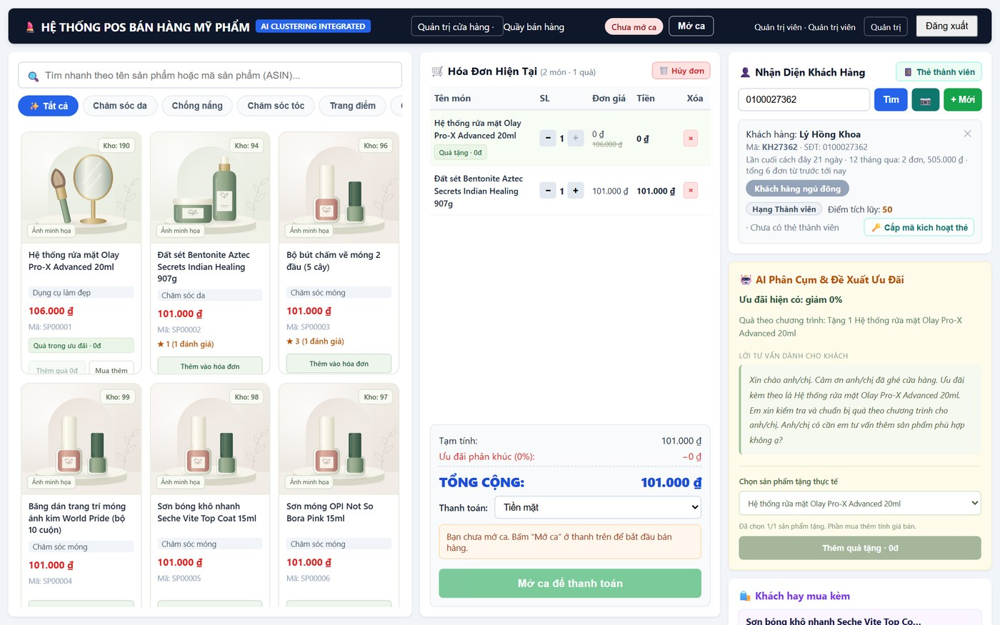

- Nhập **số điện thoại** hoặc **mã khách** (ví dụ `0100027362` hoặc `KH27362`) → **Tìm**.
- Hoặc bấm **📷** rồi đưa mã QR trên thẻ thành viên điện thoại của khách vào camera (máy quét mã 2D dạng USB cũng dùng được với ô tra cứu).
- Khách mới: bấm **+ Mới**, nhập **Số điện thoại** và **Họ và tên** → **💾 Lưu & Áp Dụng**. Khách mới chưa thuộc nhóm nào cho tới hóa đơn đầu tiên.
- POS hiển thị: tên, mã, số điện thoại, lần mua cuối, số đơn và chi tiêu 12 tháng, **nhóm khách do AI xếp**, hạng thẻ, điểm tích lũy, trạng thái thẻ thành viên.

### 4.4. Ưu đãi theo nhóm khách và quà tặng

- Khung **AI Phân Cụm & Đề Xuất Ưu Đãi** cho biết ưu đãi hiện có (phần trăm giảm, quà) và **lời tư vấn** để nói với khách.
- Nếu ưu đãi có quà: ở **Chọn sản phẩm tặng thực tế**, chọn đúng sản phẩm quà còn trong kho → **Thêm quà tặng · 0đ**. Quà phải đi cùng ít nhất một sản phẩm mua.
- **POS không có ô giảm giá tay.** Số tiền giảm chỉ đến từ ưu đãi đã được quản lý duyệt; máy chủ tự tính lại tổng tiền khi thanh toán.
- Khách thuộc **nhóm đối chứng** (khoảng 10%) không được ưu đãi của lần đo đó; màn hình hiện ghi chú để thu ngân biết.

### 4.5. Gợi ý mua kèm

Khung **🛍️ Khách hay mua kèm** hiện tối đa 3 sản phẩm còn hàng thường được mua cùng sản phẩm trong giỏ, kèm lý do. Bấm **+ Thêm** để đưa vào hóa đơn.

### 4.6. Đổi điểm

- Quy đổi: **100 điểm = giảm 10.000 đ**, theo từng bội 100 điểm, tối đa **50% hóa đơn** sau ưu đãi.
- Điểm chỉ dùng được sau khi **quét mã QR trên điện thoại của khách** bằng nút 📷 (hiệu lực 15 phút cho một hóa đơn). Chỉ gõ số điện thoại thì không dùng được điểm, để tránh tiêu điểm của người khác.
- Sau khi quét, chọn số điểm ở ô **Dùng điểm**.

### 4.7. Thanh toán

1. Kiểm tra **Tạm tính**, **Ưu đãi phân khúc**, điểm đã dùng và **TỔNG CỘNG**.
2. Chọn **Thanh toán**: Tiền mặt, Chuyển khoản hoặc Thẻ.
3. Bấm **⚡ THANH TOÁN & TRỪ KHO**. Hệ thống lưu hóa đơn, trừ kho theo lô hạn gần nhất trước, cộng điểm và cập nhật nhóm khách trong cùng một giao dịch.
4. Hóa đơn hiện ra để in → **Đóng & Tạo đơn mới**.

Tích điểm: **1 điểm / 10.000 đ khách thực trả** (làm tròn xuống) × hệ số hạng thẻ: Thành viên ×1, Bạc ×1,5 (chi tiêu tại cửa hàng 12 tháng từ 2.000.000 đ), Vàng ×2 (từ 5.000.000 đ).

### 4.8. Thẻ thành viên và mã kích hoạt

- **📱 Thẻ thành viên:** hiện mã QR để khách quét bằng điện thoại và mở trang thẻ.
- **🔑 Cấp mã kích hoạt thẻ** (sau khi đã tra cứu khách): tạo mã **6 số**, hiệu lực **10 phút**, dùng một lần. Dùng cho khách đã mua ở cửa hàng nhưng chưa có thẻ, hoặc khách quên PIN.

### 4.9. Thu / chi tiền mặt trong ca

Bấm **Thu/chi tiền mặt** → chọn **Chi ra khỏi két** hoặc **Thu vào két**, nhập số tiền và lý do (ví dụ “Nộp bớt tiền về két chính”) → **Lưu phiếu**. Không chi được quá số tiền đang có trong két.

### 4.10. Kết ca

1. Bấm **Kết ca**.
2. **Đếm tiền trong két theo mệnh giá** (500.000 đ … 500 đ); máy tự cộng. Ca không có tiền mặt thì không bắt buộc đếm (có nút **Trong két vẫn có tiền? Đếm tiền** nếu cần).
3. Hệ thống tính **Tiền mặt phải có = tiền đầu ca + bán tiền mặt + phiếu thu − phiếu chi** và chênh lệch.
   - Lệch trong **±10.000 đ**: kết ca bình thường, ghi *Khớp*.
   - Lệch **quá ±10.000 đ**: phải ghi lý do (từ 10 ký tự); ca chuyển sang **Chờ xác nhận** để quản lý đối soát (mục 3.12).
4. **Xác nhận kết ca**. Bấm **Báo cáo ca** để xem, **In báo cáo**, **Xuất doanh thu (CSV)**, **Xuất quà tặng (CSV)**.

Sau khi kết ca phải mở ca mới mới bán tiếp được. Mỗi nhân viên chỉ có một ca mở tại một thời điểm.

---

## 5. Dành cho Khách hàng – trang thẻ thành viên

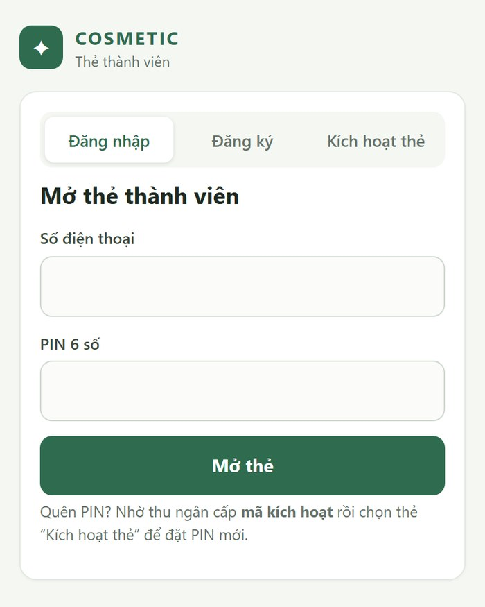

Khách quét mã QR ở quầy hoặc mở địa chỉ `/member` trên điện thoại. Trang có ba thẻ:

| Thẻ | Dùng khi | Cách làm |
|---|---|---|
| **Đăng ký** | Khách mới, chưa có trong hệ thống | Nhập họ tên, số điện thoại, đặt **PIN 6 số** → **Đăng ký và nhận thẻ** |
| **Kích hoạt thẻ** | Khách đã từng mua ở cửa hàng hoặc quên PIN | Nhờ thu ngân **Cấp mã kích hoạt** → nhập số điện thoại, mã 6 số, PIN mới → **Kích hoạt** |
| **Đăng nhập** | Các lần sau | Nhập số điện thoại + PIN → **Mở thẻ** |

Sau khi đăng nhập, khách xem được:

- Thẻ thành viên theo màu hạng, **mã QR đổi mỗi 60 giây** (đưa cho thu ngân quét để tích và đổi điểm).
- Điểm hiện có và số tiền quy đổi, thanh tiến độ lên hạng, **ưu đãi đang có**, 10 hóa đơn và 10 lần cộng/đổi điểm gần nhất.
- **Đánh giá sản phẩm đã mua** tại quầy: chọn 1–5 sao, viết nhận xét (tối đa 500 ký tự) → **Gửi**. Lần đánh giá đầu tiên có nhận xét từ 20 ký tự được **+10 điểm**.

Bảo mật: nhập sai PIN 5 lần thì thẻ bị khóa 15 phút; thông báo lỗi không tiết lộ số điện thoại có tồn tại hay không. Có thể chọn “Thêm vào màn hình chính” để mở như một ứng dụng.

---

## 6. Kịch bản demo khi báo cáo với GVHD

Gợi ý trình bày trong khoảng 15 phút, đi theo đúng mạch “dữ liệu → mô hình AI → chiến lược → áp dụng tại quầy → đo hiệu quả”:

| Bước | Thao tác | Điều cần nhấn mạnh |
|---|---|---|
| 1 | Mở SSMS, cho xem database `cosmetic_crm_db` (25 bảng) | CSDL thiết kế và lưu trữ trên Microsoft SQL Server |
| 2 | Đăng nhập `manager` → **Tổng quan** | Số liệu thật: 13.6xx hóa đơn, 3.26x khách, 200 sản phẩm |
| 3 | Bấm K = 2…10 ở ô chọn số nhóm, chỉ biểu đồ Elbow / Silhouette | Cách chọn số cụm; K = 3 có Silhouette cao nhất, phiên bản đang dùng chọn K = 4 để tách nhóm VIP |
| 4 | **Mô hình phân cụm** → thước đo, kiểm tra lệch, lịch sử phiên bản | Mô hình nền cố định, khách mới không làm trôi nhóm; phát hiện lệch và huấn luyện lại có kiểm soát |
| 5 | **Xem trước** một cách chia khác (không bấm áp dụng) | Ma trận chuyển nhóm; xem trước không ghi CSDL |
| 6 | **Chiến lược ưu đãi** → hỏi **Trợ lý phân tích** | Ưu đãi gắn với từng nhóm; AI đề xuất, người quản lý duyệt |
| 7 | Mở **POS** bằng `nhanvien1` → mở ca → tra cứu `0100027362` → thêm sản phẩm, chọn quà → thanh toán | Nhóm khách và ưu đãi hiện ngay khi tính tiền; máy chủ tự tính tiền, trừ kho theo lô |
| 8 | **Gợi ý mua kèm** trong POS và trang quản trị | Luật kết hợp support – confidence – lift |
| 9 | **Hiệu quả ưu đãi** → **Chạy mô phỏng** | Nhóm đối chứng 10%, kiểm định z; dữ liệu thật hiện chưa đủ nên báo “chưa đủ dữ liệu” |
| 10 | Kết ca → **Ca làm việc** → **Đối soát** | Nghiệp vụ vận hành hoàn chỉnh |

Chuẩn bị trước buổi demo: bật SQL Server, Spring Boot, FastAPI; đăng nhập sẵn; kiểm tra camera nếu muốn demo quét QR; nếu demo trợ lý AI cần có Internet và khóa Gemini.

---

## 7. Câu hỏi thường gặp

**Vì sao gần như toàn bộ khách đều ở nhóm “Khách hàng ngủ đông”?**
Dữ liệu nền OnlineSales kết thúc tháng 01/2021, nên tính tới hôm nay các khách này đã không mua quá 365 ngày. Đây là kết quả đúng với thực tế, không phải lỗi. Khách mua mới tại quầy được xếp nhóm theo hành vi thật.

**Thêm khách mới có làm thay đổi các nhóm đã học không?**
Không. Mô hình chỉ học khi bấm **Áp dụng phiên bản này**; khách mới chỉ được đặt lên thước đo đã lưu. Điều này đã được kiểm chứng bằng kiểm thử tự động (thêm 400 khách chi tiêu rất lớn, thước đo và nhóm của khách cũ không đổi).

**Xem thử số nhóm ở trang Tổng quan có làm thay đổi gì không?**
Không. Đó chỉ là xem thử; quầy POS vẫn dùng phiên bản đang áp dụng cho tới khi bạn Xem trước và Áp dụng ở trang Mô hình phân cụm.

**Dịch vụ AI (FastAPI) tắt thì sao?**
Quầy POS vẫn bán hàng, lưu hóa đơn, trừ kho bình thường; chỉ không áp dụng được ưu đãi theo nhóm và không có gợi ý AI cho tới khi dịch vụ chạy lại.

**Tại sao khách không dùng được điểm?**
Thu ngân phải quét mã QR trên điện thoại của khách (trong 15 phút gần nhất) và thẻ phải đã được kích hoạt. Khách vãng lai không có điểm.

**Dữ liệu nào là mô phỏng?**
Họ tên, số điện thoại của khách dữ liệu nền; 50 hóa đơn bán tại quầy tạo bằng `seed_store_sales.py` (ca có ghi chú *“Dữ liệu bán hàng mô phỏng”*); hạn dùng và giá gốc của lô tồn đầu kỳ (lô `DK-…`). Dữ liệu giao dịch nền là dữ liệu thật của bộ OnlineSales.
